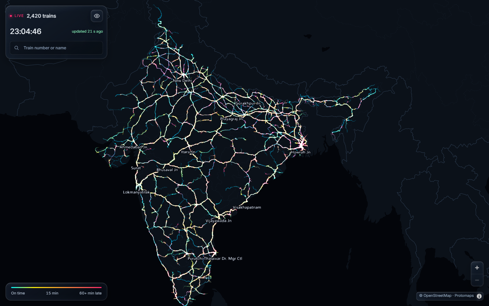
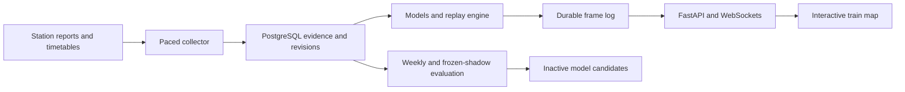

# mSyndicator

An evidence-driven Indian railway tracker that turns station reports and timetables into probabilistic arrival forecasts and an interactive map.

mSyndicator retains when each report was received, reconstructs what was knowable at a past instant, and models how delays can evolve along a journey. The dashboard brings together estimated train positions, delay colours, route selection, station timelines, and arrival prediction ranges.



## What it does

- Collects and validates train-status reports through a paced, budgeted dispatcher with durable request records and circuit breakers.
- Stores append-only event revisions and receipt timestamps in PostgreSQL for reproducible, receipt-causal replay.
- Combines LightGBM quantile models and empirical distributions with particle-based simulation to estimate arrival times and uncertainty.
- Replays affected journeys deterministically and publishes durable full or delta frames over a FastAPI WebSocket API.
- Renders the railway network with MapLibre, deck.gl, and self-hosted PMTiles, with searchable trains, selectable routes, delay colouring, and stop details.
- Evaluates weekly candidates against active models, records promotion eligibility, and registers candidates inactive for manual review.
- Guards manual and scheduled evaluations with a shared host lock, a runtime limit, and container cleanup.

Map movement between reported stations is estimated from the journey model. Train details distinguish observed, stale, and timetable-only evidence.

## Architecture



## Stack

| Layer | Technologies |
|---|---|
| Collection and API | Python 3.12, httpx, FastAPI, WebSockets, MessagePack |
| Evidence store | PostgreSQL 16, psycopg |
| Forecasting | NumPy, Numba, LightGBM, PyArrow |
| Dashboard | TypeScript, Vite, MapLibre GL, deck.gl, PMTiles |
| Deployment | Docker Compose, Caddy, Linux host tooling |
| Verification | pytest, Vitest, replay and recovery checks |

## Local development

Install the locked Python and web dependencies from the repository root.

```sh
uv sync --frozen
npm --prefix web ci
```

Run the offline Python checks, frontend checks, and dashboard build.

```sh
uv run pytest -q -m "not db"
npm --prefix web test
npm --prefix web run build
```

The full Python suite uses isolated databases on a local PostgreSQL instance. Start the development database with Docker Compose, then run the complete suite.

```sh
docker compose up -d db
uv run pytest -q
```

`MSYND_TEST_DSN` selects the test database server. On Windows, an explicit `127.0.0.1` address can avoid localhost connection stalls. Environment examples are in [.env.example](.env.example).

A running dashboard also needs imported schedules and network data, available model artifacts, and self-hosted map tiles. Follow the [deployment guide](docs/deploy.md) for application setup and asset preparation.

## Evaluation and operations

Weekly evaluation trains on earlier service dates and validates on the most recent two complete IST weeks. Eligibility uses paired forecast cases, CRPS improvement, confidence-interval support, calibration, and per-class regression checks. Model promotion is a separate manual operation.

Frozen shadow candidates use their recorded artifacts, parameters, hashes, and validation window. Their held-out screening results are tracked separately from weekly promotion eligibility.

The guarded evaluation launcher is [deploy/evaluate.sh](deploy/evaluate.sh). Operational evidence, deployment procedures, and recovery details live under [docs](docs/).

## Repository guide

| Directory | Contents |
|---|---|
| `msynd/collect` | Dispatch, validation, evidence storage, and run lifecycle |
| `msynd/engine` | Evidence assembly, inference caching, particle replay, and frame publication |
| `msynd/models` | Empirical and quantile-model artifacts and registry operations |
| `msynd/eval` | Receipt-causal cases, baselines, scoring, and eligibility gates |
| `msynd/api` | Read-only REST and live WebSocket endpoints |
| `msynd/static` | Timetable imports, railway geometry, and network export |
| `msynd/ops` | Evaluation, retention, backups, and operational reports |
| `web` | Map dashboard and frontend tests |
| `tests` | Unit, integration, numerical, and recovery checks |
| `docs` | Design, implementation plans, measured gates, and deployment notes |

## Project status and data sources

mSyndicator is a research-stage product with ongoing forecast and operational validation. Source access, data retention, training, and redistribution permissions are tracked in the [source-use notes](docs/sources.md). Public source code and captured development fixtures are available in this repository. Provider-specific permissions still govern further data use and commercial distribution.
