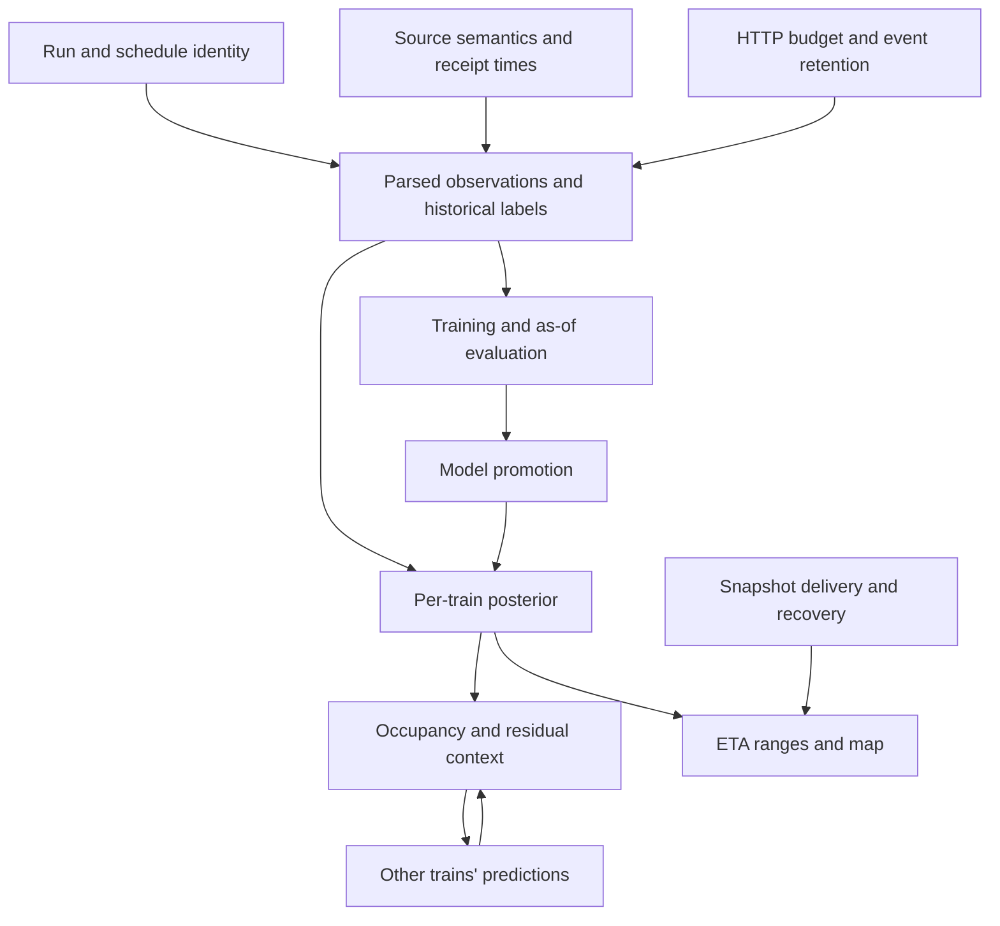

# Adversarial review: live all-India train tracker

**Review date:** 2026-10-07, IST. **Verdict:** do not implement v1 as written. The main blockers are observation semantics, immutable run identity, information-availability leakage, and an unproven collection budget. Rust does not resolve those blockers.

Reviewed [the design](B:/m-syndicator/docs/superpowers/specs/2026-10-07-live-train-tracker-design.md) in full. The repository currently contains the design, with no collector, simulation implementation, recorded observation stream, or benchmark results to validate. This is a design review, not an implementation test or an Oracle performance measurement.

Evidence is separated into **observed** public-page behavior, **counterexamples** to the written contract, and **unverified** assumptions requiring a pilot. A counterexample demonstrates that the proposed rule is insufficient; it does not claim a nonexistent implementation has already failed.

Companion artifacts:

- [Evidence and public-source excerpts](B:/m-syndicator/docs/superpowers/reviews/2026-10-07-live-train-tracker-evidence.json).
- [Runnable arithmetic and state-transition counterexamples](B:/m-syndicator/docs/superpowers/reviews/2026-10-07-live-train-tracker-checks.py). Run `python docs/superpowers/reviews/2026-10-07-live-train-tracker-checks.py`; 19 counterexamples were verified.

## The four Phase 0 dependencies

| Dependency | What this review established | Adversarial verification required | Blast radius and smallest defensible fix |
|---|---|---|---|
| NTES boards retain actual times after departure | **Unverified.** NDLS and BPL boards were fetched. Their interface explicitly says “Trains in Next” 2/4/8 hours. The NDLS sample included an unstarred 14:28 arrival for destination train 12621 at a board time of 14:34, while future times were starred. This demonstrates that a board can contain a recently actual arrival; it does **not** establish retention of departed trains or its duration. | Follow identified trains before arrival, during dwell, and after departure, including short halts, late running, midnight, and busy/quiet stations. Match actual arrival and departure against train status using origin start date. Measure the time from an event becoming visible to its disappearance, source publication lag, and usable actual events per board request. Repeat over at least a full weekly operating pattern before making a nationwide capacity claim. | Loss of board actuals removes the proposed observation multiplier. The 90% targeted fallback does not preserve a 40-minute poll cycle even at one request/poll. Treat boards as discovery/baseline data until the actual-event contract is demonstrated. Use confirmed train-status events and set an explicit freshness target supported by measured capacity. Nationwide schedule-based estimates can remain available, with honest stale/unknown labels. |
| NTES map provides GPS positions | **Refuted for the sampled map flow.** Train 12449’s map sets `cStn` to ADVI, describing departure from ADAVALI at 14:19. Its marker uses `getStnLatLng(cStn[0])`, with coordinates from station-map data. This is a station marker derived from the same running-status event, not an independent moving GPS fix. One sample does not prove that every NTES product lacks GPS. | Require a documented coordinate source, measurement timestamp distinct from fetch time, accuracy/uncertainty, and movement between stations. Compare against station coordinates and repeated responses. Test whether the map and status are transformations of one observation. A timestamped station marker still fails this gate. | Feeding this as independent GPS double-counts a report and falsely concentrates the posterior. Disable `obs.position` for this flow. Consume the station event once. Add position observations only when an independent measurement contract is established. |
| etrain delay is arrival or departure delay | **Still unverified.** The 12951 yearly page contains 365 dated rows for eight station labels, 2025-10-01 through 2026-09-30, consistent with the spec’s narrow example. Labels identify stations, not event kind. Its `train-history?train=12951` request returned HTTP 200 with a search form, not a slug redirect. A search suggestion returned MUMBAI RAJDHANI, allowing the proper history URL to be resolved. | Pair station-day values with NTES runs having materially different arrival/departure delays. Cover origin, destination, intermediate long dwells, overnight and multi-day runs, early running, non-daily trains, missing data, repeated stations, and timetable changes. Test origin-start date versus station-local date. Matching cases where both delays are equal proves nothing. Capture comparisons in the same historical availability window; the yearly sample ends before the current live enquiries. | Wrong semantics corrupt targets, dwell, reconstructed timestamps, leakage checks, and ETA evaluation. Record event kind and date semantics explicitly; quarantine unresolved history from event-level training. “Swap the meaning” is insufficient because arrival-to-arrival and departure-to-arrival targets require different clocks and dwell treatment. Live-only training remains viable while history is unresolved. |
| Simulation meets the Oracle budget; otherwise rewrite in Rust | **Unverified and unavailable in this repository.** There is no kernel or Oracle benchmark evidence. Numba is already native compiled code; a Rust rewrite has no demonstrated speed benefit. | Benchmark on the actual A1 allocation with the database, API, collector and refresh jobs running. Time forward movement, likelihood evaluation, resampling, RNG, display selection, CDF inference, six-hour forecasts, serialization, database writes and cold rebuild separately. Include bursts, extreme delays, several possible current legs and p95/p99 latency, not just one average advance call. | A slow inference/forecast/database stage survives an `advance_particle` rewrite. Change the gate to profiling plus a feasible workload budget. Reduce particles to the smallest count supported by accuracy evidence, batch/cache fitting queries, and optimize the measured bottleneck. Port only an identified CPU bottleneck after a comparative prototype establishes improvement; recheck correctness and the whole pipeline. |

### Collection arithmetic already contradicts the fallback

The browser submission code calls `GetCSRFToken` before `frm.submit()`. Reusing one token produced a nonempty first board, followed by empty HTTP 200 responses for another board and a train enquiry. Fresh-token enquiries then returned nonempty BPL and running-status pages. This is a spot check, not a proof of every token rule; it is enough to reject an untested assumption that tokens can be reused for 30 minutes. Empty HTTP 200 must be treated as invalid content.

Let `h` be HTTP requests per logical enquiry, including necessary token fetches. The lower bound for a complete targeted sweep is `active_runs × h / (HTTP_rate × targeted_share)`. These are optimistic lower bounds: no retries, discovery, exceptions, schedule imports, or extra lookup requests are included.

| Case: 2,500 active runs, 1 HTTP request/s | Best possible targeted sweep |
|---|---:|
| All requests targeted, `h=1` | 41.67 minutes |
| 70% targeted, `h=1` | 59.52 minutes |
| Phase 0 fallback: 90% targeted, `h=1` | 46.30 minutes |
| 70% targeted, `h=2` | 119.05 minutes |
| Phase 0 fallback: 90% targeted, `h=2` | 92.59 minutes |

At the guaranteed 30% board share, 200–400 stations take 11.11–22.22 minutes to sweep for `h=1`, or 22.22–44.44 minutes for `h=2`. If actual reports disappear sooner, set cover over route distance cannot prevent missed events. Stops 150 km apart also do not guarantee observations within a fixed time: a held or slow train may spend hours between them.

**Fix:** one host-wide HTTP dispatcher owns enquiry requests, tokens, session initialization, redirects, retries, exceptions and static imports. Measure `h` rather than assuming it. Admit polling work against measured throughput and event retention. Add age-based fairness so high-uncertainty trains cannot permanently starve the rest. Do not solve the deficit by silently increasing the agreed request rate.

## Blockers in the written design

### 1. The training and simulation clocks disagree — critical

**References:** §7.1, lines 421–431; §8.1–8.3, lines 521–565.

History is assumed to give arrival delay at intermediate halts, so `d_B - d_A` is arrival-to-arrival. Live examples use departure from A to arrival at B. The particle duration includes dwell at A plus running time. These are different targets, not interchangeable observations of one target.

**Counterexample:** A has scheduled dwell 10 minutes, arrival delay 0 and departure delay 15; B has arrival delay 20. History’s delta is +20; the live departure-to-arrival delta is +5. Actual dwell is 25 minutes. Training both as the same target shifts the live target by 15 minutes, even with perfect parsing.

The statement that dwell time is “departure delay minus arrival delay” is also wrong as a time value: that difference is the **change in dwell relative to schedule**. Actual dwell is `scheduled_dwell + departure_delay - arrival_delay`.

**Blast radius:** every training example, duration sample, passing-time likelihood, ETA, calibration result, and congestion residual. This is systemic prediction error.

**Fix:** define one clock contract before training. The simplest option compatible with arrival-only history is arrival-at-A to arrival-at-B, including dwell at A, with an explicit origin-departure special case. Alternatively separate departure-to-arrival running time and arrival-to-departure dwell, using live data when the historical source lacks both. In either case, specify `t_enter`, `sched_T`, delay kind, origin/destination rules and dwell consistently. Add the counterexample above as a regression case.

### 2. The leakage rule allows unavailable information — critical

**References:** §5 `obs.event`, lines 235–245; §7.2, lines 444–449; §7.5, lines 507–514.

`actual_ts < forecast_time` does not mean the system knew the event then. A station event at 10:00 that arrives at 10:20 must not enter a 10:15 forecast. The spec’s leakage test would accept it. Final corrected historical reports are particularly dangerous: their reconstructed occurrence time says nothing about their publication time.

“NTES snapshot closest to the cut point” can select a future snapshot. That is not a valid as-of baseline. Train target encoding, historical slack, calibration and residuals also need to be fit only on each training fold. Time splits alone do not prevent those leaks.

**Blast radius:** model selection and filter tuning look better than live performance; the promotion gate can approve a worse model; S2/S3 cease to be credible. Leaked context can affect every coupled train.

**Fix:** retain each observation revision’s actual time **and** reception/availability time. Features at time `t` use only information received by `t`; forecasts are stored at issuance. Use the latest valid NTES ETA fetched **at or before** `t`, with a maximum baseline age. Derive labels from later matured actuals, separately from feature eligibility. Fit transforms within the training fold. Final historical rows may supply targets, but must not masquerade as a replay of a live information stream.

### 3. Mutable stop sequences can corrupt historical identity — critical

**References:** §5, lines 172–205, 225–245, 267–273; §6.2, lines 381–388; §11, line 689.

Events reference `(run_id, seq)` while `ref.train_stop` is a mutable global schedule. Inserting a passing station before an existing halt renumbers downstream stops. Yesterday’s event for seq 2 can become today’s passing station instead of yesterday’s halt. A timetable edit, special train-number reuse, or changed route creates the same problem.

There is no explicit halt-to-segment membership in the schema despite network features and route export requiring it. Directed `(from_stn, to_stn)` pairs do not identify shared physical occupancy across reverse routes, alternative lines or differently subdivided routes. Historical `(train, run_date, station)` also cannot represent repeated occurrences of one station without ambiguity.

**Blast radius:** historical truth is silently reinterpreted, training joins break, replay changes after imports, old forecasts use new routes, and one mapping error can contaminate other trains through coupling.

**Fix:** bind each run to an immutable schedule/route version. Identify stop occurrences within that version; enrich passing stations through a new version rather than rekeying existing observations. Add explicit ordered route-to-physical-segment membership before coupling. A small versioned schedule representation is sufficient; this does not require a generic graph platform or PostGIS.

### 4. The checkpoint cannot handle the late data it claims to handle — critical

**References:** §5, lines 235–245, 357–360; §8.3, lines 545–565.

After folding an event at 10:20, the checkpoint is at 10:20 and the next query selects only event times after it. A newly received 10:10 event, a corrected 10:10 time, or a departure at the same minute as an already folded arrival is omitted. Rewinding to the last folded observation cannot incorporate information older than that observation. Counting revisions without retaining their previous values and availability times is insufficient.

PostgreSQL NOTIFY targets currently listening sessions; LISTEN registration disappears when the session ends. It is a wake-up signal, not durable delivery. Updates made during an engine/API disconnect will not be recovered automatically.

**Blast radius:** the posterior misses truth while appearing healthy; process restarts produce different estimates; exceptions can leave cancelled/diverted runs simulated unless their changes also trigger reconciliation.

**Fix:** consume durable observation changes by reception order, with a commit-safe cursor or transactionally maintained dirty-run set. Do not assume that arbitrary sequence IDs alone give commit ordering. Retain revisions. For a changed run, replay its canonically ordered observations from initialization using its bound versions; this is the simplest correctness-first approach. Add an earlier checkpoint only if replay cost warrants it. After committing LISTEN, reconcile stored state, then use notifications for prompt wakeups and periodic reconciliation for recovery. Include run-status changes in the same mechanism.

### 5. The particle state and likelihood contract lose necessary information — high

**References:** §8.1–8.3, lines 523–565; §13, lines 709–716.

The state stores only the current leg and its timing. Advancing a particle to an observation’s actual time can move an early particle past the observed station and overwrite the very duration needed to score that arrival/pass. The four arrays do not retain the crossed event’s predicted time. The likelihood needs a station-specific candidate event time before that information is lost.

Other contract failures:

- `leg_km / max_kmh_leg` is hours; state durations are minutes. The physical floor needs the factor 60, explicit treatment of missing speed, and dwell if total duration includes it.
- A total-duration floor alone can still permit excessive running speed after dwell consumes most of that duration.
- Clipping late-train dwell to at most scheduled dwell cannot represent a prolonged station hold, including the 25-minute dwell in the clock counterexample. Attributing all extra time to motion puts the train on the track while it is still at the station.
- Gaussian roughening of the **current** duration can make its end earlier than now or invalidate an already observed pass/departure. Minimum duration must satisfy physical constraints and the observed history.
- “Every weight underflows” is not a reliable divergence rule. Stable log-sum-exp normalization avoids that underflow; naïve exponentiation introduces numerical resets. Equal, very unlikely predictions can retain high effective sample size.
- Position observations compare kilometers but reuse an unlabeled Laplace scale `2.0`; units, GPS accuracy and projection ambiguity are absent.
- A Laplace scale `b` is not a hard bound. An observation cannot be required to put every particle within `b`, especially when the prior contains no such particle.

**Blast radius:** incorrect likelihoods, impossible trajectories, frozen posterior support or needless resets; these errors contaminate forecasts and coupling.

**Fix:** specify event-directed advancement that preserves the candidate station time. Enforce clock, dwell, route-distance and positive-speed invariants. Rejuvenate only unobserved state, respecting elapsed time and prior observations. Trigger reset on a defined predictive incompatibility criterion, independently of numerical normalization and ESS. Disable position likelihoods until genuine fixes and units are known. Replace the collapse test with a posterior/calibration test that allows observation noise.

### 6. Rebuild determinism is not established by fixed seeds — high

**References:** §4, line 151; §8.6–8.8, lines 604–615; §13, lines 714–716.

Seeds depend on `batch_no`. Identical observations delivered in one batch or two batches change RNG initialization, resampling and roughening. The same reports therefore need not reproduce the same posterior. Rebuilding under today’s model, schedule, bias, coupling state and parameters differs from the historical engine even if random numbers match.

Identical CPU/GPU random arrays also do not guarantee bitwise floating-point equality. Small differences can change a leg-boundary branch. Forecast RNG use must not perturb the live filter’s RNG stream.

**Blast radius:** restart jumps, inconsistent benchmarks, unreproducible comparisons, and a parity gate that fails for harmless floating-point differences.

**Fix:** define deterministic processing and RNG keys from canonical observation identity/revision and particle lineage, independent of transport batches; separate forecast draws. Bind state/replay to model, feature, schedule, bias and parameter versions, plus the relevant context snapshot. For v1, reproducible rebuilding under one explicitly fixed version is a reasonable contract; do not promise exact reproduction of historical live beliefs without retaining their inputs or checkpoints. Test CPU/GPU semantic agreement with documented tolerances and boundary cases.

### 7. Network context is trained on information unlike live estimates — high

**References:** §3, lines 101–106; §7.2–7.3, lines 441–467; §8.5, lines 589–593; §11, line 686.

Final daily delays at halt stations do not supply past posterior positions, neighbor spacing, freight locations, route occupancy, publication delays, or within-leg speeds. Reusing feature code does not make final historical information statistically equivalent to noisy, stale online posteriors.

A posterior split between 0 km and 200 km has mean 100 km, where no particle is located. Assigning that mean to one physical segment creates phantom occupancy. A whole-leg residual also cannot locate its cause on each segment the leg touches. Applying that same residual as an additive correction on multiple segments would multiply it. Recent slowdowns, nightly biases and the trained context term can further explain the same error repeatedly.

**Blast radius:** a bad estimate for one run becomes false context for other runs; their responses reinforce the error. Interval coverage can fail during common disruptions because factored filters discard shared correlation.

**Fix:** first validate a per-train model with available static/time/delay features. Add network features only after causal replay can reconstruct what was actually observable. Use posterior probability or overlapping time intervals over canonical segments rather than assigning a multimodal mean to one segment. Keep residual correction at the identifiable leg level until finer observations localize it; define aggregation so a residual is accounted for once. Require an ablation showing benefit and calibration under real collection latency before enabling coupling nationwide.

### 8. Geometry errors affect prediction as well as drawing — high

**References:** §6.2, lines 383–388; §7.2, lines 438–442; §15, line 806.

The “only drawing” mitigation contradicts the use of OSM paths for distance, track count, electrification, maximum speed, neighbors and segment bias. Shortest path can choose a freight bypass, wrong station node, incorrect line or disconnected topology. Splitting a halt-to-halt edge when passing stations appear can change neighbor membership without a physical change.

**Blast radius:** physical time floors, learned features, occupancy and correlated forecasts are wrong on affected corridors, extending to other trains sharing the mistaken segments.

**Fix:** separate geometry confidence from trustworthy timetable distance. Validate station-code mapping, ordered station continuity and route-length consistency. Prefer observed official station sequences when available. Exclude uncertain physical mappings from occupancy coupling and OSM-derived features; draw uncertain geometry explicitly. Missing `maxspeed` must not invent an authoritative speed constraint. Manual overrides should be versioned with the route.

### 9. CDF tails and forecast query coverage are incomplete — high

**References:** §3, lines 108–115; §7.3, lines 453–460; §8.4, lines 575–587; §8.6, lines 601–603.

An overflow bin gives tail probability, not a finite value to sample. A uniform offset inside an unbounded bin is undefined. The neural 302-class head has no tail-value rule; the quantile model’s exponential tails require parameters and consistency with its extreme quantiles. Exact bin edges and their count also need a convention, not just integer labels.

CDFs are cached only for “current leg and next 2.” A six-hour forecast is estimated at about eight legs, and uncertain particles can occupy several different legs now. The kernel contract does not say where those uncached queries get their distributions. Future queries also need future time and evolving context, not an undocumented reuse of now’s context.

**Blast radius:** extreme delays are clipped or sampled incorrectly, forecasts cannot advance through their advertised horizon, and rare-event calibration is overstated.

**Fix:** define bin edges, normalized masses and finite overflow sampling or explicit censored output. Enforce physical support and measure the distributional effect of flooring. Cache by complete versioned query inputs for all requested legs, with bounded on-demand inference; do not assume three legs cover a posterior or forecast. Start with an explicit context-free forecast, then validate any future coupling. Interpolate delay levels if evaluation warrants it; the 360-to-600 gap is not a universal “half-step” error bound on the output distribution.

### 10. The all-India success criteria can pass without useful live truth — high

**References:** §1, lines 49–55; §6.2–6.3, lines 395–415; §14, lines 753–776.

S1 can count a schedule-initialized estimate as “live,” without fresh evidence. There is no independently enumerated NTES running population in the design, so a denominator based on discovered runs hides undiscovered trains. S5 limits dashboard-to-engine age, not source-event age: fresh animation can present hour-old information. S6 counts hours with no data anywhere; one successful board per hour can pass while most trains are unobserved.

Scheduled end plus 12 hours can retire a badly delayed train still running. A 36-hour timestamp rejection rule can discard a real extreme delay instead of distinguishing it from an identity error. `rescheduled`, `diverted`, and `part_cancelled` are operational attributes as well as states; a single status enum can overwrite lifecycle meaning. Newly discovered runs/status changes must reach the engine promptly, beyond the daily 00:10 initialization.

Phase 1’s “3,500 trains with 300 days of history” confuses calendar rows with operated runs. A weekly service has about 52 annual runs. Empty daily placeholders are not 300 usable training examples. The backfill estimate counts one request per train despite specifying slug lookup plus history: two requests for 3,900 trains at 0.2/s take 10.83 hours before retries.

**Blast radius:** deployment appears to meet coverage/completeness while stale, missing or misidentified runs dominate; the yearly-data exit gate is impossible for some valid train classes.

**Fix:** report scheduled coverage, discovered running coverage, and sufficiently observed coverage separately. Track per-run last source event and received time, unknown/stale status, missing-event rates and observation-age percentiles by corridor/class. State an independent denominator or disclose that nationwide coverage cannot yet be measured. Use schedule versions, service calendars including exceptions and origin start date; confirm termination where possible and use explicit expiry uncertainty. Measure history completeness against expected operated runs, not 365 dates. Define the long-distance service inventory and resolve unknown train classes before setting numeric coverage targets.

### 11. The rate limiter does not satisfy the stated rate limit — high

**References:** S4, line 52; §6.1, lines 367–377; §13, line 707.

A standard initially full token bucket at 1/s with capacity 3 permits three requests at time zero and one at seconds 1–59: 62 requests in `[0,60)`. That exceeds S4’s 60 requests per arbitrary 60 seconds, despite respecting the token bucket. Separate collector/static-import processes also have separate in-process buckets. Retries, token requests and session refreshes must use the same limiter.

The circuit breaker misses semantically wrong HTTP 200 responses if validation is only syntactic. The observed empty-token-reuse responses are a direct example. Returned expected times must not be promoted to actuals solely because a train’s scheduled time has passed. Endpoint-specific failures can also come from one shared broken session.

**Blast radius:** excess host traffic, source blocking, and silent observation outages that poison the model’s apparent freshness.

**Fix:** implement the specified rolling-window/start-spacing rule in the single HTTP owner, or explicitly revise S4 to a token-bucket contract before implementation. Keep transport status, session validity and semantic page validity distinct. Validate train/run/station identity, actual-versus-expected markers, coherent day offsets and nonempty content. Honor `Retry-After` where provided; stop unsupported challenges rather than treating them as ordinary data. Test host-wide accounting under concurrent imports, retries and session recovery.

### 12. Forecast delivery and client recovery are underspecified — high

**References:** §8.6, lines 596–604; §9, lines 623–627; §10, lines 656–681.

`sim.latest['frame']` overwrites the previous delta. If an API listener misses delta A and then receives delta B, reading the latest payload cannot recover A. A requested full snapshot is described, but no source of complete per-run display state or protocol to detect gaps is specified. A train removal/status change also needs a delta/tombstone contract.

The API selects a train by number although several origin-date runs may coexist. It promises every upcoming halt and a histogram, but persistent outputs describe only three-halt summaries and 32 six-hour display trajectories. Those display particles are selected by current position quantiles, not specified as weighted samples of future delay; ties at a station can hide very different future departure delays. They cannot establish the advertised interval accuracy.

The forecast size assumes 6-byte `(leg,t_enter,dur)` records without specifying quantization. Using the stated int16 and two float32 fields takes 10 bytes, so the estimate is 6.4 MB before headers, not approximately 4 MB. Compression might reduce it; an actual wire contract must establish that.

**Blast radius:** silently inconsistent browser state after disconnect, wrong date selected, unsupported ETA ranges and frontend resource usage above estimates.

**Fix:** maintain one complete latest snapshot, with generation/sequence numbers and a defined full-resync path on gaps. For one personal client, full frames may be sufficient; measure them before adding delta retention. Address runs explicitly by run ID/origin date, and bind frames to network/model versions. Compute ETA summaries from the weighted posterior for all requested halts independently of animation sampling. Specify binary encoding, precision and measured compressed sizes. Coalesce or resync slow clients without unbounded queues.

### 13. “Ground-truth replay” cannot show the actual interstation path — medium/high

**References:** G3, lines 30–33; §9, line 626; §10, lines 656–661; §17, line 843.

Station events do not reveal where a train waited between stations. Interpolating them with `pos()` produces a reconstructed path, even if endpoints are known exactly. Revisions overwrite previous events, so it is also latest corrected truth, not necessarily what the source or filter believed then. A newly opened browser has no 30-minute live buffer; smooth rewind through that interval is unavailable immediately.

**Blast radius:** the UI presents inferred movement as observed truth and offers a timeline segment it cannot reconstruct after reload.

**Fix:** label replay as observed station events plus estimated motion; preserve gaps/uncertainty. Describe latest-corrected replay separately from historical beliefs. Backfill an empty browser interval with that reconstructed replay, or show its unavailable portion. Store past forecasts only as required for evaluation, without introducing a full belief-replay platform. Test reload, network loss, clock drift, changing static-network versions and large fast-forward jumps.

### 14. Model promotion does not prove the advertised gain — high

**References:** S2/S3, lines 50–51; §7.4–7.5, lines 489–515; §14, lines 767–782.

The promotion gate requires 2% CRPS improvement over the active model, while S2 requires 10% median-error improvement over both persistence and NTES at two different horizons. Those are different conditions. Broad calibrated intervals can pass coverage while being uninformative; width and proper scoring matter. P10–P90 is an 80% interval, so additional quantiles are needed for a 90% coverage check.

Repeated selection against the most recent full week turns that week into validation, not an untouched test set. Cut points from the same train-day and neighbors during one disruption are correlated; one week and a few aggregate percentages do not establish a stable gain. Exact horizon selection must not use eventual actual arrival time to decide which forecasts were “2 hours ahead.”

The cited Dutch paper explicitly says its GATv2 model was challenged on MAE by persistence. The Indian 2510.01262 paper predicts **station-period average arrival delay**, not per-train six-hour arrival distributions. These sources motivate experiments; they do not justify the chosen architecture or S2 target. The older Markov paper’s abstract studies n-order models; it is not validation of first-order behavior for this system’s delayed inputs and disruptions.

**Blast radius:** sophisticated models are shipped without delivering the goal; costly retraining and particle tuning optimize a misleading gate.

**Fix:** store issued forecasts, baseline snapshots and mature actuals. Evaluate each stated horizon using predeclared issuance/target rules and identical eligible cases, showing baseline availability and age. Use proper scores plus interval width/coverage, class/corridor/disruption breakdowns, and confidence estimates grouped by run/day rather than independent cut points. Keep a later untouched evaluation period. Select a neural model only if its practical gain over LightGBM/persistence survives these checks and fits runtime cost. Treat numeric gains as acceptance conditions to demonstrate, not guaranteed deliverables.

### 15. Storage, recovery and free infrastructure are optimistic — high

**References:** §5, lines 347–355; §7.4, lines 475–477; §11–12, lines 685–701; §15, lines 803–805.

The 200 GB budget excludes PostgreSQL indexes/WAL, raw retention churn, model/export staging, tiles, container layers and seven database dumps. “Forever” retention has no finite upper bound. The sampled station/running-status pages were roughly 0.4–1.4 MB **uncompressed**, substantially larger than the original small-page example; actual zstd sizes must be measured before revising the storage estimate.

The weekly Kaggle export lists selected reference/history/event/run tables and code. It omits, among other state, NTES ETA snapshots, positions and `ml` artifacts/configuration; it is not a complete recoverable system backup. A failed weekly job also prevents that export backup from completing. Local dumps on the same storage do not protect against loss of that storage. Restore time and permitted data/model loss are unspecified.

Oracle’s documentation defines idle through CPU 95th-percentile, network and A1 memory thresholds over seven days. “The engine keeps CPU busy” is not a capacity or retention guarantee. Always Free A1 capacity may also be unavailable in the home region. The reviewed page does not establish the spec’s blanket assertion that PAYG automatically exempts an Always Free resource from idle reclamation. Package names having ARM packages does not prove the pinned Python/Numba/ONNX/LightGBM/container combination works.

**Blast radius:** collector downtime loses the very history needed for evaluation; storage pressure can impair the database; a replacement VM cannot restore consistent simulation state.

**Fix:** measure database size with realistic indexed rows, WAL, compressed pages, PMTiles and dump sizes; give each retained dataset a bounded policy and reserve disk headroom. Keep a small independent off-site backup of database state, versions and needed model artifacts; perform a restore into a fresh instance and measure recovery time. Check the actual Oracle allocation and published reclaim policy rather than generating artificial load. Pin and smoke-test the ARM serving image and exported model early. Kaggle failure must keep a working model without relying on a failing training/export job for recovery.

### 16. Permission to view pages is not a complete data-use contract — medium/high

**References:** §2, lines 63–77; §7.4, lines 473–477; §15, line 802; §17, line 829.

The plan moves from “personal/non-commercial” to an assumption that bulk automated access, model training, portfolio presentation and uploading data to Kaggle are all covered. They are distinct uses. Absence of CAPTCHA is a technical observation, not permission or an uptime promise. This review did not establish the applicable licenses/terms for those uses or their current scope.

**Blast radius:** the historical-data or cloud-export dependency can become unusable, requiring a new training corpus. A private dataset setting must be verified rather than assumed from kernel metadata.

**Fix:** record the applicable source/feed/map licenses and terms with retrieval date, including automated collection and private third-party export. Keep raw source data local until the relevant use is established; send only permitted derived data when possible. Verify dataset privacy separately from kernel privacy. If rights or reliable access cannot be established, use a permitted source or live data that can lawfully be collected. This is a dependency check the spec itself needs, not a reason to invent extra infrastructure.

## Every section challenged

| Design section | Assessment | Required change before relying on it |
|---|---|---|
| §0 Summary | A probabilistic tracker is plausible; “what actually happened” overstates station-only position evidence. | Use the clock/observation contract and truthful reconstruction labels. |
| §1 Goals and S1–S7 | Several metrics can pass with stale data; accuracy/performance are unproven. | Define measurable coverage/freshness, evidence-backed performance profiles and as-of accuracy gates. |
| §2 Facts | Narrow 12951 history example confirmed; redirect contradicted; GPS not established; papers do not prove model choice. | Turn facts into source-specific contracts with fixtures and uncertainty. |
| §3 Factored model | Reasonable first experiment; coupling and hidden-segment attribution are not demonstrated. | Validate a per-train baseline first; define CDF tails and defer unidentifiable segment effects. |
| §4 Architecture | One package, one image, Postgres and no Redis/Kafka are appropriate. | Keep this simplicity; add durable reconciliation and single HTTP ownership. |
| §5 Data model | Does not preserve schedule identity, observation revisions or sufficient as-of evaluation inputs. | Add immutable run binding, revision availability and issued forecast records before collection. |
| §6 Collector | Requests, token lifetime, retention and fairness invalidate the capacity assumption. | Measure logical-to-HTTP cost; validate semantics and missing/stale cases; own all host requests centrally. |
| §7 Learning | Mixed clocks and availability leakage undermine training and backtests. | Fix labels, fold-local features, causal replay, horizon matching and model selection. |
| §8 Engine | Current state loses observed-leg timing; rewind/reset/determinism/cache contracts are incomplete. | Specify invariants before optimization; benchmark complete workloads. |
| §9 API | Snapshot recovery, run date, all-halt ETAs and histogram sources are unspecified. | Expose run IDs, complete summaries and generation-based resync. Keep basic auth/TLS and private DB. |
| §10 Dashboard | Interpolated truth, empty recent buffer and display sampling can mislead; 60 fps unmeasured. | Label inference; handle missing windows/resync; benchmark actual payloads, routes and trails on named hardware. |
| §11 Nightly updates | Segment attribution is unidentifiable and backup coverage incomplete. | Begin with one versioned leg-level correction; back up and restore required state independently. |
| §12 Operations | Free resources and wheels are assumptions, not a tested deployment. | Prove image compatibility, capacity, bounded storage and recovery. |
| §13 Tests | Useful fixtures/parity intent, but tests omit identity, receipt-time leakage and reconnection, and assert incorrect collapse/determinism rules. | Replace invalid assertions; add the actual invariant counterexamples and recovery tests. |
| §14 Delivery | Too much irreversible data interpretation precedes validation; history and collector exits can be misleading. | Rewrite Phase 0 as contract/capacity gates; keep nationwide expansion contingent on evidence. |
| §15 Risks | Several mitigations do not mitigate their named risks. | Correct “drawing only,” old-checkpoint rewind, underflow resets, CPU-busy retention and personal-use assertions. |
| §16 Suburban | Explicitly outside v1; its source/liveness assertions were not independently audited here. | Leave out of this implementation; verify sources when that separate spec is reviewed. |
| §17 Decisions | All-India from day 1 and fixed model/filter complexity are commitments ahead of evidence. | Preserve all-India as the goal; record source/accuracy/runtime gates before treating it as launch-ready. |

## Blast radius ordering

The dangerous failures are silent. A route-version error or mistaken event type can produce smooth animation and well-formed numbers, then spread across trains through context. Fix **identity → observation semantics → availability → collection capacity → evaluation → filter correctness → coupling → performance → dashboard**, in that order. Changing Python to Rust before these contracts are correct accelerates invalid predictions.

The most contained failures are rendering quality and a missing optional GPS source, provided they cannot masquerade as independent truth. Model-training infrastructure is also containable if the validated CPU model remains usable and backups are independent.

## Recommended replacement for Phase 0

1. **Write executable data contracts before a bulk import.** Specify origin start date, schedule version, stop occurrence, event kind, actual-versus-expected marker, measurement time and received time. Resolve the arrival/departure clock with discriminating fixtures. Unknown history semantics are an explicit failed gate, not an assumption silently promoted to truth.
2. **Prove collection capacity.** Count every HTTP request with the actual CSRF/session flow. Follow board rows through departures and measure retention/publication delay; measure expected active inventory and board yield across a weekly service pattern. State feasible per-run observation-age targets. If the 1/s budget cannot support them, keep nationwide schedule estimates and identify observed/stale coverage honestly; a different data source, scope or target is a material design decision.
3. **Persist evidence needed for real evaluation.** Preserve observation revisions/availability, run/schedule binding, NTES baseline snapshots and issued forecasts. Establish as-of joins and a recovery path. Historical daily rows must not fabricate availability timestamps or unobserved passing events.
4. **Prove the simplest baseline first.** Schedule, carried delay and a per-train/statistical or LightGBM model should run on a causally replayable sample. Demonstrate downstream ETA improvement and calibration before selecting thousands of particles, neighborhood attention, segment congestion or GPU filter sweeps.
5. **Benchmark the actual serving workload and recovery.** Use the Oracle machine if available; otherwise record this gate as unavailable. Include competing services, model inference, all requested forecast legs, observation bursts and frame creation. Benchmark a Rust alternative only for a demonstrated native-kernel bottleneck.
6. **Prove operational prerequisites.** Serving image/model smoke test; permitted source use and private-export settings; measured disk budget; a restore into a fresh environment. Keep Kaggle training optional and outside the recovery critical path.

**Exit rule:** each gate has a result of pass, fail, or unavailable, with fixtures/measurements and a recorded decision. Fixtures alone are not an exit criterion. Failed capacity must change the source, freshness promise or rollout contract; failed labels must change training data/clock semantics; failed runtime must change the measured bottleneck. None is resolved merely by adding Rust or more particles.

## Verification record and limits

- Read all 845 lines of the design and inspected repository file inventory/status. There was no implementation to execute and no captured Phase 0 fixtures before this review.
- Public HTTP spot checks established the endpoint JavaScript, per-submit token fetch, empty responses after token reuse, valid responses with fresh tokens, two station-board interfaces, passing stations in one running-status page, station-derived map coordinates, and the narrow 12951 yearly-history example. No cookies or CSRF token values are included in the consolidated evidence.
- Read the cited papers’ public abstracts, GTFS README, Oracle Always Free resource page, and PostgreSQL LISTEN/NOTIFY documentation. These checks do not constitute a full literature audit or legal determination.
- Ran the companion standard-library check: **19 counterexamples verified**, exit code 0. It proves arithmetic and synthetic contract counterexamples, not prediction quality, actual event retention, implementation correctness or hardware performance.
- Still unavailable/unverified: longitudinal departed-row retention; the 20-train etrain event-kind/date comparison; nationwide inventory/freshness; real model accuracy/calibration; Oracle runtime/rebuild and ARM image; GPU pipeline/quota/privacy; measured storage/restore and applicable bulk-use/export rights.

Primary references: [NTES](https://enquiry.indianrail.gov.in/mntes/), [submission helper](https://enquiry.indianrail.gov.in/mntes/javascripts/mntes_utility.js?v=3), [etrain search-form URL](https://etrain.info/train-history?train=12951), [12951 yearly history](https://etrain.info/train/Mumbai-Rajdhani-12951/history?d=1y), [GTFS README](https://github.com/Neo2308/indianrailways-gtfs), [Markov paper](https://arxiv.org/abs/1806.02825), [Indian station-delay paper](https://arxiv.org/abs/2510.01262), [Dutch autoregressive graph paper](https://arxiv.org/abs/2510.09350), [Oracle Always Free](https://docs.oracle.com/en-us/iaas/Content/FreeTier/freetier_topic-Always_Free_Resources.htm), [PostgreSQL LISTEN](https://www.postgresql.org/docs/16/sql-listen.html), [PostgreSQL NOTIFY](https://www.postgresql.org/docs/16/sql-notify.html).
